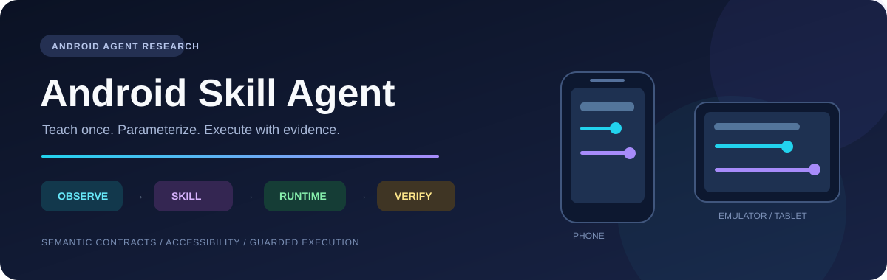
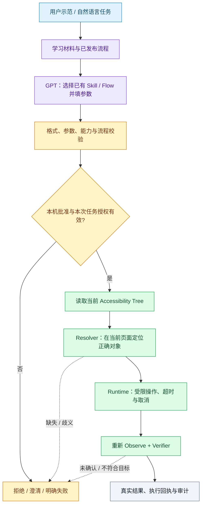

<p align="center">
  
</p>

<p align="center">
  
  
  
  
</p>

<h3 align="center">把「怎么用 App」整理成可检查、可参数化、可复用的操作知识。</h3>

<p align="center">
  <a href="#项目在解决什么问题">项目想法</a> ·
  <a href="#系统怎样工作">系统架构</a> ·
  <a href="#快速开始">快速开始</a> ·
  <a href="docs/STATUS.md">实际进度</a> ·
  <a href="docs/ROADMAP.md">下一步计划</a>
</p>

## 项目在解决什么问题？

一个人学会操作 App 后，能不能把操作方法保存下来，让下一位用户、下一台终端继续使用，而不是重新培训、重新写点击脚本？

本项目围绕这个问题，搭建 Android 智能家居操作研究原型。重点不是「让大模型随便点屏幕」，而是将**自然语言理解、流程契约、环境定位、真实操作和结果验证**分开设计。

> **GPT 理解用户想做什么；程序检查能不能做、在当前 UI 怎么做；最后再次观察，确认是否真的完成。**

例如，示范中的「亮度60%」不应永远固化成一条60%的轨迹。它可以成为`SetBrightness(device, percent)`的参数；再次调用时，依据当前设备的控件与状态执行，而不是照搬旧坐标。

## 系统怎样工作？



**Skill 与环境不是一回事。** Skill描述任务语义、参数约束与目标；Binding保存App页面及控件线索；宿主设备信息由运行时读取。`args.device`是灯、空调等业务实体，不是手机序列号。

更详细的模块职责：[架构说明](docs/ARCHITECTURE.md)。

## 当前源码包含什么？

| 模块 | 作用 |
|---|---|
| **Demo Probe / Android Agent** | 示范采集、草稿审查、Skill/Flow管理、Accessibility执行及结果界面 |
| **Parameter Room** | 可重置的智能家居实验App，提供灯、亮度、空调温度等受控能力 |
| **Host Runtime** | 学习、候选检查、发布、导入、任务构建、设备桥接与版本化存储 |
| **Model Gateway** | 中英文语义映射、结构化输出、请求预算与取消；密钥留在宿主端 |
| **P1—P5参考模块** | Flow契约、编译、页面观察、学习材料、候选发布、执行与迁移相关源码 |
| **测试与审计** | 原生纯逻辑测试、服务审计检查、超时/取消/回执合同和本地校验工具 |

代表性参数化能力包括`SetPower`、`SetBrightness`与`SetTemperature`。具体实体、合法范围与可用能力仍以实际Registry和App实现为准，不将一个实验能力外推为任意App支持。

```text
Android-Skill-Agent/
├── android/
│   ├── agent/                 # Android Agent / Probe109候选
│   └── parameter-room/        # Room6受控实验App
├── host/                      # 宿主产品链路与版本化存储
│   └── runtime-dependencies/  # P1—P5参考源码与语义契约
├── model-gateway/             # 模型语义桥与安全约束
├── examples/                  # 不含执行权的说明性输入
├── scripts/                   # 构建与公开源码检查
└── docs/                      # 架构、使用方法、状态与研究路线
```

## 快速开始

### 1. 获取项目

```bash
git clone https://github.com/xiru0834-eng/Android-Skill-Agent.git
cd Android-Skill-Agent
```

### 2. 构建两个 Android App

需要JDK17、Android SDK34与Build Tools34.0.0。项目提供标准Gradle描述，也提供Windows离线构建脚本。

```powershell
# 显式指定本机SDK路径；不要照抄研究机器的固定磁盘路径。
./scripts/build-android.ps1 -SdkPath 'D:/Android/Sdk'
```

APK生成在`android/*/build/manual/`。脚本只构建，不安装、不启动App、不操作手机。

> 新机器生成的debug签名可能与现有研究安装不同。不要为了安装而直接卸载旧App——卸载会丢失本地数据。优先在空白实验设备上使用，或先按自己的备份与签名策略处理。

详细准备步骤见[构建与体验](docs/GETTING_STARTED.md)。

### 3. 先运行免费、离线检查

```powershell
python scripts/check-source.py
./android/agent/test-core.ps1
./scripts/test-service-audit.ps1
```

这些检查不调用模型、不访问手机。**纯逻辑检查、APK构建、真实设备执行与真实模型端到端，是四种不同的证据。**

### 4. 阅读真实进度，再选择实验入口

仓库提交的是**研究源码快照**，不是已经封口的稳定版本：

- 109原生审计补丁已应用，APK已在研究机实际构建。
- 当前109的Android资格与GPU对照尚未完成；不能写成整套端到端PASS。
- Host部分保留了研究环境的路径／制品校验，原始设备证据和本机批准没有公开。完整Host链路不能按「clone以后自动可用」宣传；重新部署需要配置和重新校验，不能删除这些守卫强行运行。
- 同一App的设备复用，与任意App／任意UI自动学习，是不同研究目标。

详见[状态与验证边界](docs/STATUS.md)，不要把历史批次结果自动归给当前候选。

## 为什么这个方向有价值？

1. **减少重复教学。** 把操作经验整理成可审查的知识，而不是每换一台终端就重新示范。
2. **从轨迹走向能力。** 分开示范值与参数，研究流程能否适用于不同目标值和初态。
3. **让失败可定位。** 将理解、校验、定位、执行和核验分层；超时、歧义与未确认不冒充成功。
4. **把安全放进执行机制。** 模型只提议，程序负责授权；不将导入、草稿或相似控件当成执行许可。

这是一组需要实验验证的设计目标，不是已经证明所有场景都成立的性能承诺。

## 路线图

| 阶段 | 研究重点 | 当前定位 |
|---|---|---|
| ① 示范与保存 | 收集操作证据，审查、命名和管理流程 | 已有实现，按入口和版本核对证据 |
| ② 参数化Skill | 明确动作与参数，校验约束，闭环执行 | 已有实现，持续回归 |
| ③ 同App跨设备复用 | 真机、模拟器／Pad，不搬运旧坐标 | 有历史实验；当前109仍待现场资格与完整确认 |
| ④ UI变化适应 | 页面记忆、条件导航、自动重新绑定 | 后续研究，不在此仓库宣称已通过 |
| ⑤ 真实App与使用价值 | 代表任务、培训成本和用户体验 | 需明确授权、代表任务与独立评估 |

下一步的具体工作见[研究路线与验收](docs/ROADMAP.md)。

## 安全与公开范围

仓库不包含API密钥、签名私钥、配对码、本机执行批准、手机备份、用户原始录制或模型请求日志。API Key只在本地环境变量／凭据管理器配置，**不放进APK、Skill文件或Git**。

仅在已授权、可恢复的实验App与设备上使用。不要以本项目代替真实家电、敏感应用或生产环境的安全审批。详见[安全说明](SECURITY.md)。

本仓库目前未指定开源许可证；公开源码用于项目展示，不自动授予第三方任意再许可权利。
